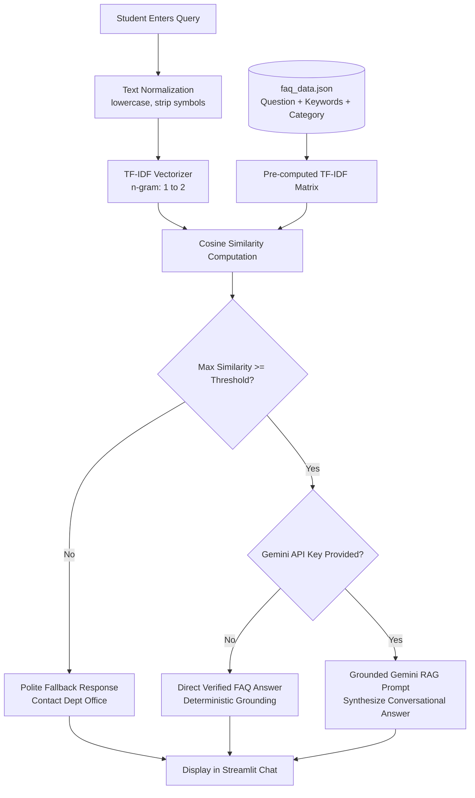

# AI-Powered FAQ Generator and Chatbot for a College Department
**MCA Generative Artificial Intelligence Lab Practical Examination Project**

---

## 1. Project Overview & Objective

This project is a web-based, retrieval-grounded FAQ chatbot designed for a college **Master of Computer Applications (MCA) Department**. It enables students to query department information regarding **Admissions, Courses, Examinations, Attendance, Fees, Placements, and Facilities**.

### Key Principles
1. **Deterministic Grounding & Zero Hallucination:** The system answers strictly using the verified FAQ knowledge base. It never fabricates policies, fees, dates, or placement packages.
2. **Polite Fallback Handling:** If a student asks an out-of-scope, unsupported, or speculative question, the chatbot gracefully returns an official departmental contact fallback message.
3. **Dual Execution Mode:**
   - **Default Local Mode (Zero Cost, 100% Offline):** Uses Scikit-learn's **TF-IDF Vectorizer + Cosine Similarity** to match queries. Requires no API keys and incurs no costs.
   - **Optional Hybrid RAG Mode:** If a Google Gemini API key is provided, the matched FAQ context is passed into a strictly-prompted Generative AI model (`gemini-1.5-flash`) to generate a natural conversational response without altering verified facts.

---

## 2. Project Folder Structure

```text
Q1/
│
├── index.html          # Lightweight, standalone HTML5/JS web frontend (instant browser test)
├── server.py           # Zero-dependency Python HTTP server (python server.py)
├── app.py              # Streamlit web interface, NLP pipeline, and retrieval logic
├── faq_data.json       # Structured knowledge base with 28 illustrated FAQ entries
├── test_faq.py         # Automated unit test suite (pytest / unittest)
├── requirements.txt    # Python package dependencies
└── README.md           # Documentation, setup guide, and viva preparation
```

---

## 3. Technology Stack

- **Language:** Python 3.9+
- **Frontend / UI:** Streamlit
- **Information Retrieval:** Scikit-Learn (`TfidfVectorizer`, `cosine_similarity`), NumPy
- **Generative AI Layer (Optional):** Google Generative AI SDK (`google-generativeai`)
- **Knowledge Storage:** Structured JSON (`faq_data.json`)
- **Testing:** Pytest / Python standard `unittest`

---

## 4. Setup and Execution Instructions

### A. Windows (PowerShell or Command Prompt)

```powershell
# 1. Navigate to the project directory
cd c:\Users\Admin\Documents\Q1

# 2. Create a virtual environment named 'venv'
python -m venv venv

# 3. Activate the virtual environment
# In PowerShell:
.\venv\Scripts\Activate.ps1
# (Or in Command Prompt: .\venv\Scripts\activate.bat)

# 4. Upgrade pip and install required dependencies
pip install --upgrade pip
pip install -r requirements.txt

# 5. Run automated tests to verify retrieval and fallback logic
python test_faq.py
# (Or with pytest: pytest test_faq.py -v)

# 6. Launch the Streamlit web application
streamlit run app.py

# --- ALTERNATIVE: Instant Zero-Dependency Browser Testing ---
# Run the standalone HTML frontend without Streamlit:
python server.py
# (Or simply double-click index.html in your file explorer!)
```

### B. macOS / Linux (Terminal)

```bash
# 1. Navigate to the project directory
cd /path/to/Q1

# 2. Create a virtual environment
python3 -m venv venv

# 3. Activate the virtual environment
source venv/bin/activate

# 4. Upgrade pip and install dependencies
pip install --upgrade pip
pip install -r requirements.txt

# 5. Run automated tests
python test_faq.py
# (Or: pytest test_faq.py -v)

# 6. Launch the Streamlit application
streamlit run app.py
```

The application will open in your default browser at `http://localhost:8501`.

---

## 5. Knowledge Base Structure (`faq_data.json`)

The dataset contains **28 question-answer pairs** across 7 department categories:

| Category | Topics Covered |
| :--- | :--- |
| **Admissions** | Eligibility criteria, lateral entry, admission process, required documents, guidance contact. |
| **Courses** | Program duration, specializations/electives (AI/ML, Cloud), capstone internship, certifications. |
| **Examinations** | CIE/SEE marks weightage (40:60), passing criteria, revaluation process, supplementary exams. |
| **Attendance** | Minimum 75% requirement, medical leave condonation rules, ERP attendance tracking. |
| **Fees** | Payment modes, government & merit scholarships, late fee fine and refund policy. |
| **Placements** | Placement cell activities, eligibility criteria (CGPA/backlogs), recruiting companies, salary stats. |
| **Facilities** | Computing & GPU lab, library timings & IEEE digital access, hostels, campus Wi-Fi, sports/gym. |

### Replacing Sample Data with Real College Data
Each entry follows this clean schema:
```json
{
  "id": 1,
  "category": "Admissions",
  "question": "What is the eligibility criteria for admission into the MCA program?",
  "answer": "Candidates must hold a recognized Bachelor's degree...",
  "keywords": ["eligibility", "criteria", "admission", "qualification", "bca", "bsc", "percentage"]
}
```
To customize for your institution, simply edit `faq_data.json` by updating the `"question"`, `"answer"`, and `"keywords"` fields. No application code changes are required.

---

## 6. Demonstration Checklist for Practical Examination

When demonstrating to the external examiner, test these 5 queries:

### Query 1: Admissions
- **Input:** `"What is the eligibility criteria for admission into the MCA program?"`
- **Matched Category:** `Admissions`
- **Expected Output:** Explains recognized Bachelor's degree (BCA, B.Sc Computer Science/IT, or equivalent) with at least 50% aggregate marks (45% for reserved categories) and Mathematics at 10+2/graduation.
- **Viva Note:** Shows keyword matching across terms like *eligibility*, *criteria*, *admission*, and *qualification*.

### Query 2: Courses
- **Input:** `"What specializations or elective subjects are offered in MCA?"`
- **Matched Category:** `Courses`
- **Expected Output:** Mentions AI & Machine Learning, Full-Stack Web Development, Cloud Computing & DevOps, Cyber Security, and Big Data Analytics.
- **Viva Note:** Demonstrates successful semantic retrieval for academic curriculum queries.

### Query 3: Examinations
- **Input:** `"What is the weightage of internal assessment and semester exams?"`
- **Matched Category:** `Examinations`
- **Expected Output:** Continuous Internal Evaluation (CIE) carries 40% weightage, and Semester-End Examination (SEE) carries 60% weightage.
- **Viva Note:** Demonstrates retrieval of structured numerical policies.

### Query 4: Placements
- **Input:** `"How does the training and placement cell assist MCA students?"`
- **Matched Category:** `Placements`
- **Expected Output:** Highlights pre-placement training (aptitude, mock technical interviews, resume workshops) and campus recruitment drives.
- **Viva Note:** Shows coverage of career development inquiries.

### Query 5: Unsupported / Speculative Question (Fallback Test)
- **Input:** `"What will be the exact placement package offered to me next year?"`
- **Matched Category:** `Unknown` / `Fallback`
- **Expected Output:**
  ```text
  I am sorry, but I do not have verified information regarding your query in the departmental FAQ knowledge base.
  Next Steps:
  - Please contact the MCA Department Office (Room 204, Academic Block A).
  - Email: mca-office@college.edu | Helpline: +91-98765-43210
  ```
- **Viva Note:** Proves the system strictly prevents hallucinations and does not make speculative predictions.

---

## 7. How the Retrieval and Similarity Engine Works



1. **Text Normalization:** Lowercases text and strips extraneous punctuation and whitespaces (`normalize_text`).
2. **TF-IDF Vectorization:** Represents texts as numerical term-frequency inverse-document-frequency vectors with unigrams and bigrams (`(1, 2)`).
3. **Cosine Similarity:** Measures the angle between the query vector and all FAQ documents in vector space:
   $$\text{Cosine Similarity}(Q, D) = \frac{Q \cdot D}{\|Q\| \|D\|}$$
4. **Confidence Thresholding:** If the highest similarity is below the threshold (default: `0.22`), the query is flagged as unverified and the fallback is returned.

---

## 8. Limitations of the System

1. **Lexical and Keyword Dependency:** Standard TF-IDF relies on token overlap; queries using rare synonyms not present in `keywords` may score lower than dense vector embeddings.
2. **Static Knowledge Base:** The chatbot cannot automatically discover newly scheduled exam timetables or fee circulars unless the JSON file is updated.
3. **No Database State Mutation:** It is an informational FAQ assistant; it cannot register a student for exams, reset passwords, or process online payments directly.
4. **Context Window:** The basic version evaluates queries on a per-turn basis rather than maintaining multi-turn conversational coreference resolution.

---

## 9. Ten Model Viva Voce Questions & Answers

**Q1: What is the main objective of this project?**
> *Answer:* To build a domain-specific, hallucination-free FAQ chatbot for an MCA department that answers student questions on admissions, courses, exams, fees, and placements strictly using a verified JSON knowledge base.

**Q2: Why did you choose TF-IDF and Cosine Similarity for retrieval?**
> *Answer:* TF-IDF provides an interpretable, transparent, and computationally lightweight numerical representation of text without requiring expensive GPU compute or paid API services. Cosine similarity calculates orientation rather than magnitude, making document length differences irrelevant.

**Q3: How do you prevent Generative AI hallucinations?**
> *Answer:* By using strict **Retrieval-Augmented Generation (RAG)** constraints. The system retrieves verified factual content first. If the similarity score is below the threshold, the system triggers a fallback instead of allowing the model to speculate. When an LLM is enabled, it is system-prompted to answer *only* from the provided context.

**Q4: What is the purpose of the `keywords` field in `faq_data.json`?**
> *Answer:* It enriches the lexical search corpus by adding synonyms, acronyms (such as *CET*, *TC*, *CIE*, *SEE*, *GPU*, *CGPA*), and common colloquial variations that students might type.

**Q5: What is Cosine Similarity and what does a score of 1.0 indicate?**
> *Answer:* Cosine similarity measures the cosine of the angle between two multi-dimensional vectors in vector space. A score of 1.0 means the vectors point in the identical direction (exact term distribution match), while 0.0 indicates orthogonal vectors (no common words).

**Q6: What happens when an unsupported query like "What is the weather today?" is asked?**
> *Answer:* The term overlap with college academic documents will produce a cosine similarity close to zero (well below the threshold of 0.22). The retriever returns `None`, and the chatbot presents the polite departmental contact fallback message.

**Q7: What is the difference between RAG and standard LLM generation?**
> *Answer:* Standard LLM generation relies solely on pre-trained parametric weights, which can result in outdated or fabricated answers (hallucinations). RAG combines an external verified retrieval database with the LLM, grounding the response in authoritative, verifiable facts.

**Q8: How would you scale this knowledge base from 25 FAQs to 50,000 documents?**
> *Answer:* We would replace the in-memory TF-IDF matrix with a dedicated Vector Database (such as FAISS, ChromaDB, or Milvus) and utilize dense neural embeddings (such as `text-embedding-004` or MiniLM sentence transformers) with approximate nearest neighbor (ANN) search.

**Q9: Why is Streamlit suitable for this practical examination?**
> *Answer:* Streamlit allows rapid deployment of reactive Python data apps with built-in state management (`st.session_state`), chat elements (`st.chat_input`, `st.chat_message`), and dynamic UI components without needing separate HTML/CSS/JS frontend codebases.

**Q10: How can this system be updated when college policies change?**
> *Answer:* By updating `faq_data.json` or connecting the application to a headless CMS / departmental SQL database. The retrieval matrix is dynamically re-computed upon startup without requiring changes to core application logic.
